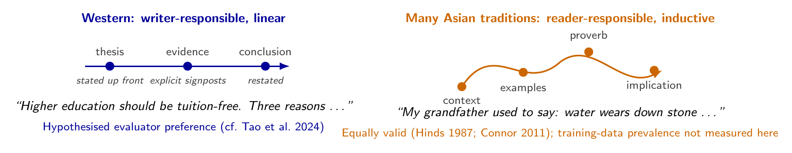
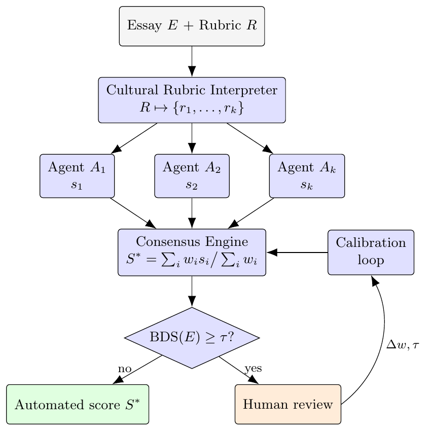
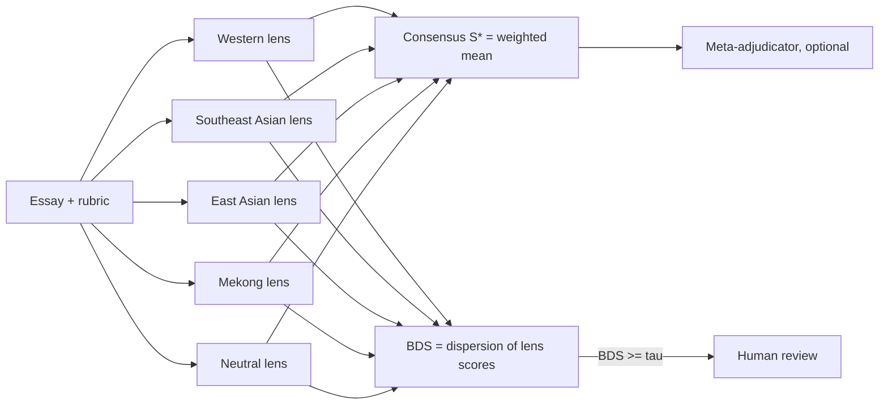
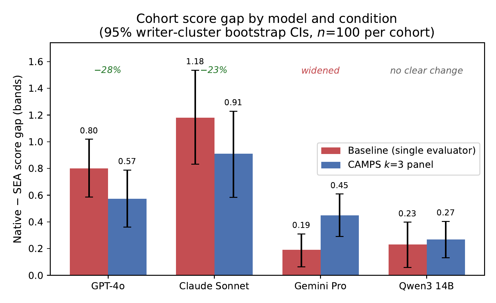
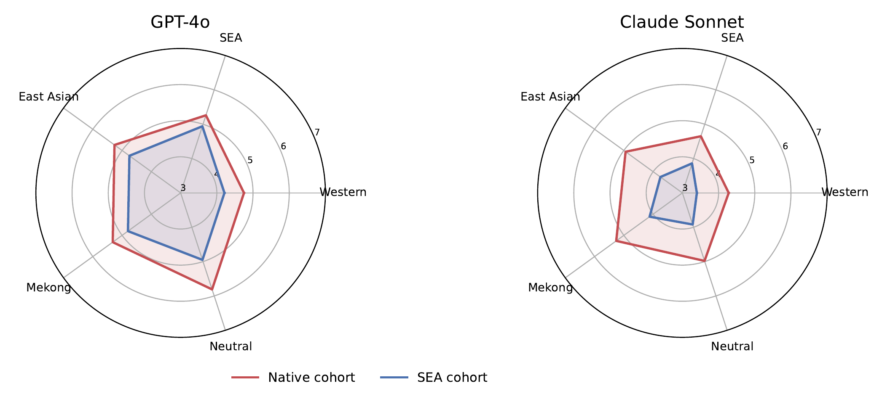
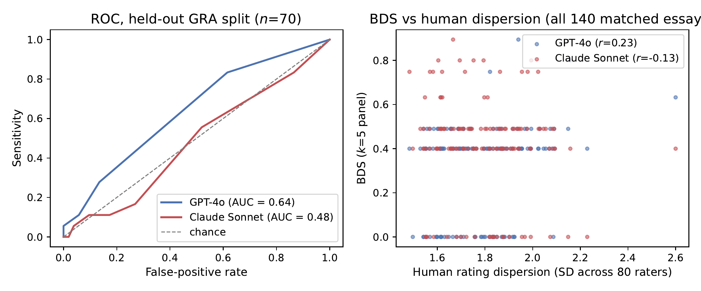
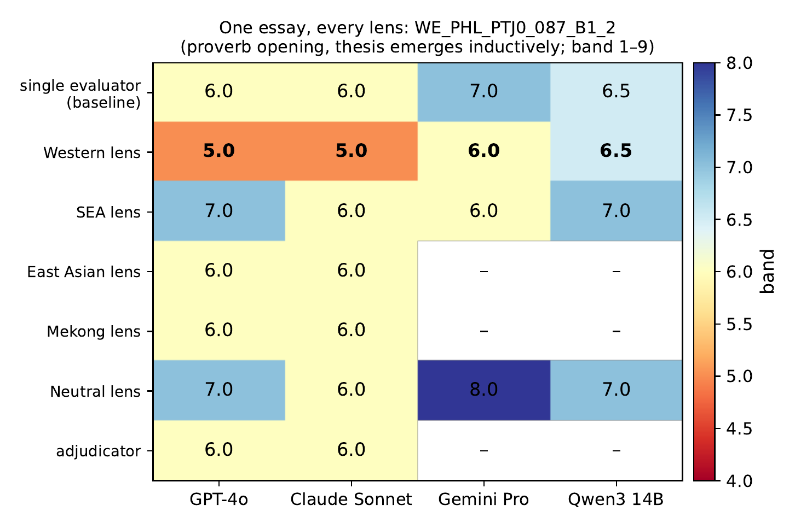
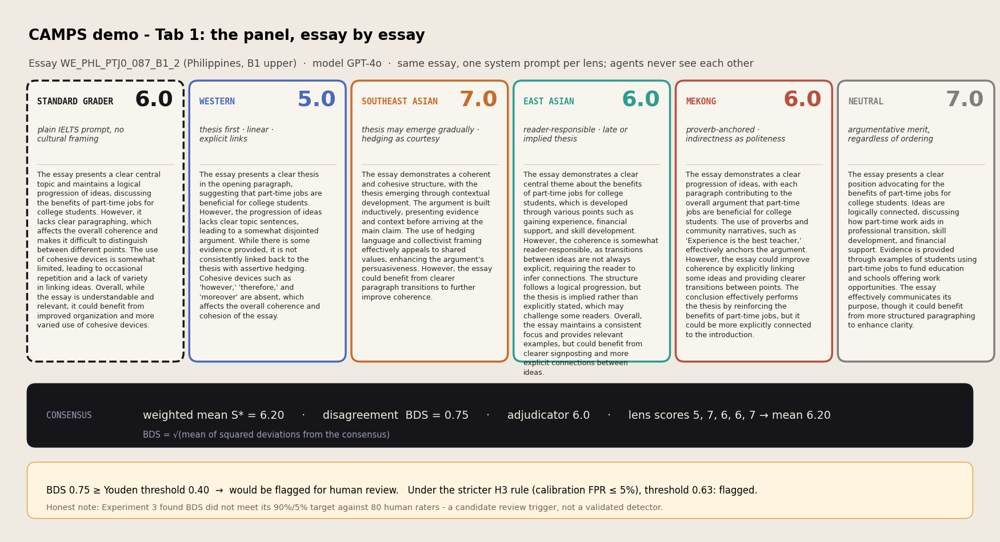
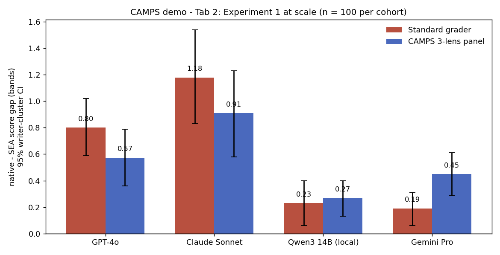
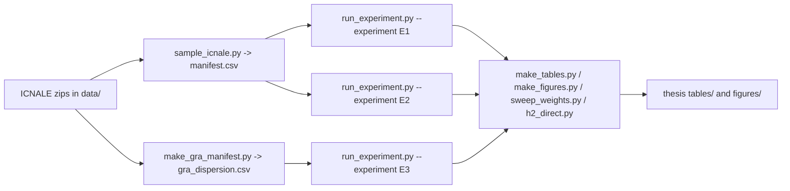

# CAMPS — Culturally-Aware Multi-Perspective Scoring

Experiment pipeline, analysis code and seminar demo for the RMIT Master of AI minor thesis
*Mitigating Evaluative Epistemic Filtering in LLM-Driven Essay Scoring: A Culturally-Aware
Multi-Perspective Scoring (CAMPS) Framework* — Bao Nguyen (s4139514), supervisor Dr Ginel
Dorleon, RMIT Vietnam, September 2026.

Every table and figure in the thesis is generated by the scripts in this repository from the
archived model outputs in `results/`. Nothing is transcribed by hand.

> **Data licence.** ICNALE essay texts are never committed. `data/` is gitignored; the repository
> holds only essay-ID manifests, prompts, configuration, logged model outputs and aggregate
> results. Obtain the corpus (free, registration) from https://language.sakura.ne.jp/icnale/.

---

## 1. The question in one figure

AI essay graders learn what "good argument" looks like mostly from Western text. Many Asian
academic traditions argue differently — context first, the conclusion arrived at rather than
announced. Both are valid; only one may be familiar to the grader.



CAMPS replaces one grader with a *panel* of evaluators, each applying a documented cultural
reading of the same rubric, averages their scores, and measures how much they disagree
(the **Bias Divergence Score, BDS**). The thesis tests whether this narrows the native−SEA
scoring gap across four model families, whether a bigger panel helps, and whether BDS can flag
essays that need a human.





---

## 2. What the thesis found (all numbers reproduce from `results/`)

**Experiment 1 — every model scored native-English essays above upper-band Southeast Asian essays**
(200 ICNALE essays, 100 per cohort, 161 writers; 95% writer-cluster bootstrap CIs).



| Model | Baseline gap [95% CI] | 3-lens panel gap | Change |
|---|---|---|---|
| Claude Sonnet 4.6 | 1.18 [0.83, 1.54] | 0.91 [0.58, 1.23] | −23% (0.27 [0.07, 0.49]) |
| GPT-4o | 0.80 [0.59, 1.02] | 0.57 [0.36, 0.79] | −28% (0.23 [0.12, 0.33]) |
| Qwen3 14B (local) | 0.23 [0.06, 0.40] | 0.27 [0.13, 0.40] | no clear change (−0.04 [−0.16, 0.08]) |
| Gemini 3.1 Pro | 0.19 [0.06, 0.31] | 0.45 [0.29, 0.61] | **amplified** (−0.26 [−0.39, −0.13]) |

The gap is an *unadjusted disparity*: the cohorts were not matched on human-judged quality, so it
is consistent with cultural filtering but does not prove it. The panel narrows the gap by marking
**both** cohorts down, the native cohort more.

**Experiment 2 — more lenses did not help.** The direct H2 test (adjudicated 5-lens panel vs the
3-lens pilot) gave a gap reduction of +0.05 [−0.03, 0.14] on GPT-4o (not supported) and
−0.10 [−0.18, −0.02] on Claude (rejected). No panel improved on its Southeast Asian lens alone
(gap 0.32 on GPT-4o, 0.79 on Claude); the "Neutral" lens gave the widest gap of the pilot lenses.



**Experiment 3 — BDS did not find the essays humans dispute.** Against the disagreement of 80
human raters on 140 GRA essays (70 held out), the threshold that H3 specified (calibration
false-positive rate ≤ 5%) caught 1/18 contested essays on GPT-4o and 0/18 on Claude; held-out
AUC 0.639 and 0.481.



**One essay, every lens** — the thesis case study (`WE_PHL_PTJ0_087_B1_2`): a proverb-opening,
inductively organised Philippine essay. The Western lens was the lowest or joint-lowest scorer
on all four models.



| Hypothesis | Verdict |
|---|---|
| H1 gap exists on ≥ 4 models | Supported, as an unadjusted disparity |
| H2 adjudicated 5 lenses beat 3 | Not supported (GPT-4o); rejected (Claude) |
| H3 BDS flags contested essays (≥ 90% sens., ≤ 5% FPR) | Not supported |
| H4 fairness–accuracy boundary | Not testable against graded truth; small in-sample trade-off on a proxy (exploratory) |

---

## 3. Seminar demo

```bash
bash run_demo.command          # builds and opens the showcase, then starts the Streamlit app
```
or step by step:
```bash
pip install streamlit plotly
python src/make_demo_summary.py      # once; regenerates results/demo_summary.json from the logs
python src/build_showcase.py         # -> demo/showcase.html (offline, self-contained; gitignored: embeds essay text)
streamlit run src/demo_app.py
```

**Showcase (`demo/showcase.html`)** — the stage piece: nine full-screen scenes with animated
reveals, driven by the logs. → / ← advance, **M** switches model, **1–3** switch featured essay,
**F** fullscreen. Scenes: title → the essay (opening highlighted) → one standard grader → five lenses
(cards + the two extreme rationales) → consensus and BDS, with the note that E3 did not validate the
trigger → the same essay under four graders → E1 at scale (animated bars with CIs) → human raters
against the panel (140 GRA essays, 80 raters each; red dots are the contested essays) → the four verdicts.

**Explorer app (Streamlit)** for Q&A:

| Tab | What it shows | API calls |
|---|---|---|
| **1 · Essay explorer** | Archived thesis scores for any of the 340 scored essays × 4 models: standard grader, 3-lens and 5-lens bars, consensus, BDS, adjudicator, verbatim rationales, 80-rater human mean for GRA essays. Three featured cases pre-selected. | none |
| **2 · What the thesis found** | E1 gap chart with CIs, E2 table with the direct H2 test, E3 detection table, H1–H4 verdicts — all from `results/demo_summary.json`. | none |
| **3 · Live scoring** | Runs the byte-identical thesis prompts on a pasted essay or a Vietnamese WEP essay (API call), or on a thesis essay (served from the cache). Runs are appended to `results/demo_history.jsonl`. | only for new essays |





*Static previews rendered from the same logs the app reads.*

**90-second run-sheet.** Tab 1, featured case A, GPT-4o → point at standard grader 6 vs lenses
5 / 7 / 7 → open the Western and Southeast Asian rationales (pre-expanded) → BDS 0.94, amber box
→ switch model to Claude (6 / 6 / 5) → Tab 2, first chart → stop. Keep Tab 3 for Q&A.

The verdict box uses the thesis thresholds (Youden 0.40; constrained 0.63 GPT-4o / 0.80 Claude)
and states that E3 did not validate BDS as a detector, so nothing on screen can contradict the
thesis.

---

## 3b. How the lenses grade

Each lens is a plain-text **system prompt** in `prompts/` (20–114 words), sent with a byte-identical
user turn containing the essay. The five lenses differ only in their four numbered rhetorical
conventions; they are called independently and never see each other. Side-by-side comparison of all
six evaluators, the shared prompt skeleton, the case essay read by two lenses, and what the prompts do
*not* contain: **[docs/HOW-THE-LENSES-GRADE.md](docs/HOW-THE-LENSES-GRADE.md)**. One file per lens — verbatim prompt, the four conventions and what each changes, the case essay's rationale on two models, and the lens's own gap at scale — in **[docs/lenses/](docs/lenses/README.md)**.

## 4. Repository layout

```
configs/experiment.yaml      models, conditions, cohorts, seed (single source of truth)
prompts/                     CRI system prompts, verbatim in thesis Appendix A
src/
  sample_icnale.py           stratified sampling manifest (essay IDs only)
  make_gra_manifest.py       GRA validation manifest + 80-rater dispersion ground truth
  models.py                  provider adapters (OpenAI, Anthropic, Google, Ollama), t = 0, JSON, disk cache
  run_experiment.py          essay × model × condition runner, resumable, JSON-lines logging
  metrics.py                 cohort gap, writer-cluster bootstrap CIs, paired reduction, Spearman
                             band association, BDS, ROC calibration
  make_tables.py             Tables 4.1–4.3 (LaTeX) from the logs
  make_figures.py            Figures 4-1 … 4-8 from the logs
  sweep_weights.py           10,626-vector consensus-weight sweep (H4) + frontier figure
  h2_direct.py               direct H2 comparison: adjudicated k=5 vs k=3, writer-cluster CIs
  make_demo_summary.py       precomputes results/demo_summary.json for the demo
  build_showcase.py          nine-scene seminar page (demo/showcase.html, gitignored)
  demo_app.py                Streamlit seminar demo
results/
  manifest.csv               380 essay IDs (100 SEA, 100 native, 140 GRA, 40 WEP demo-only)
  E1/ E2/ E3/scores.jsonl    every scoring record (9,249 lines)
  gra_dispersion.csv         per-essay human Content mean and 80-rater SD
  weight_sweep_*.csv         E2 sweep outputs
  runs.jsonl                 run records (calls issued, resumed, tokens, timestamps)
  demo_summary.json          numbers for the demo's Findings tab
  cache/                     5,971 distinct API responses (gitignored)
docs/img/                    figures used in this README
docs/HOW-THE-LENSES-GRADE.md the six evaluators' prompts side by side
docs/lenses/                 one file per lens (01-western … 05-neutral)
```

---

## 5. Setup

```bash
python -m venv .venv && source .venv/bin/activate
pip install pyyaml pandas numpy scipy scikit-learn matplotlib openai anthropic google-genai openpyxl
cp .env.example .env          # personal API keys; Ollama for the local model
```

Unzip the ICNALE modules (WE 2.6, WEP 0.7, GRA 2.1) into `data/`.

---

## 6. Reproduce the thesis



```bash
# 1. manifests
python src/sample_icnale.py --config configs/experiment.yaml
python src/make_gra_manifest.py
# 2. scoring (resumable; cached responses are reused)
python src/run_experiment.py --config configs/experiment.yaml --experiment E1
python src/run_experiment.py --config configs/experiment.yaml --experiment E2
python src/run_experiment.py --config configs/experiment.yaml --experiment E3
# 3. analysis -> ../s4139514-Final-Thesis-CAMPS/tables and figures
python src/make_tables.py --experiment E1 --results results/E1
python src/make_tables.py --experiment E2 --results results/E2
python src/make_tables.py --experiment E3 --results results/E3
python src/make_figures.py --results results/E1
python src/sweep_weights.py --model gpt-4o --out results/E2/weight_sweep_gpt-4o.csv
python src/sweep_weights.py --model claude-sonnet --out results/E2/weight_sweep_claude.csv
python src/h2_direct.py
```

Two senses of reproducibility (thesis Appendix B): every table and figure is **exactly**
reproducible from the archived outputs in `results/`; regenerating the outputs through provider
APIs is best-effort (temperature 0 reduces but does not eliminate variability).

### How the cache works

The cache key is `(model id, agent, essay id, system prompt, user prompt)` — it excludes the
experimental condition. So the 5-lens condition reused the three E1 lens scores, the adjudicated
condition reused all five, and the 13 GRA essays also in the E1 sample were served from the cache
in E3. Reconciliation (thesis Table B.1):

| Component | Scoring records | Distinct responses |
|---|---:|---:|
| E1: 4 models × 200 essays × 4 prompts | 3,200 | 3,200 |
| E2 five-lens: 2 × 200 × 5 (3 reused) | 2,000 | 800 |
| E2 adjudicated: 2 × 200 × (5 reused + 1) | 2,400 | 400 |
| E3: 2 × 140 × 5 (13 essays reuse all 5) | 1,400 | 1,270 |
| Archived Gemini 2.5 calls (excluded) | 249 | 249 |
| Smoke-test responses outside the final manifest (not analysed) | — | 52 |
| **Total** | **9,249** | **5,971** |

### Analysis details

* Cohort gap Δ = mean native − mean SEA consensus; 95% percentile bootstrap resampling **writers**
  within each cohort (10,000 resamples, seed 4139514); paired changes on the same resample.
* Band association = Spearman ρ between panel score and CEFR band on the SEA cohort (replaced QWK
  during review — the 1–9 score scale and 2-level band labels share no category system).
* E3: contested = top quartile of 80-rater Content dispersion (cut-off 1.910, n = 35); seeded
  70/70 split; flag when BDS ≥ τ; constrained τ = lowest observed BDS with calibration FPR ≤ 5%
  and maximal sensitivity; Youden τ = 0.40. Classification uses full-precision values.
* The `p` reported for gap changes is a bootstrap tail probability (share of replicates with
  reduction ≤ 0), not a null-hypothesis test.

---

## 7. Models

| Name in config | Identifier | Provider | Used in |
|---|---|---|---|
| `gpt-4o` | gpt-4o | OpenAI | E1, E2, E3 |
| `claude-sonnet` | claude-sonnet-4-6 (Claude Sonnet 4.6) | Anthropic | E1, E2, E3 |
| `gemini-pro` | gemini-3.1-pro-preview | Google | E1 (rerun after gemini-2.5-pro was withdrawn; 249 archived calls excluded) |
| `qwen3-local` | qwen3:14b | Ollama, local | E1 |

Scoring ran 18 Aug – 2 Sep 2026. Temperature 0 where the provider client exposes it (the pinned
Anthropic client used its default generation settings), JSON output requested in every call; Qwen3
returned half-bands in 295/800 calls, GPT-4o in 34/3,700.

---

## 8. Citation

Nguyen, B. (2026). *Mitigating Evaluative Epistemic Filtering in LLM-Driven Essay Scoring: A
Culturally-Aware Multi-Perspective Scoring (CAMPS) Framework.* Minor thesis, Master of
Artificial Intelligence, RMIT University Vietnam. Corpus: Ishikawa, S. (2023). *The ICNALE
Guide.* Routledge.
